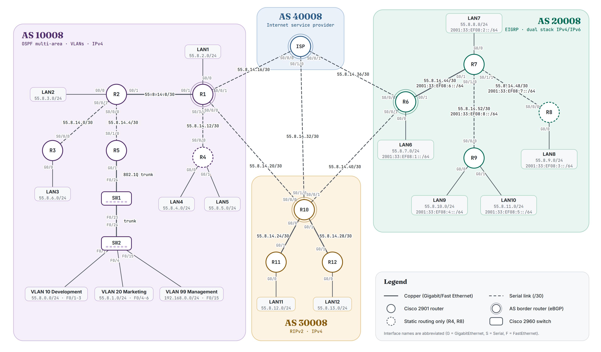
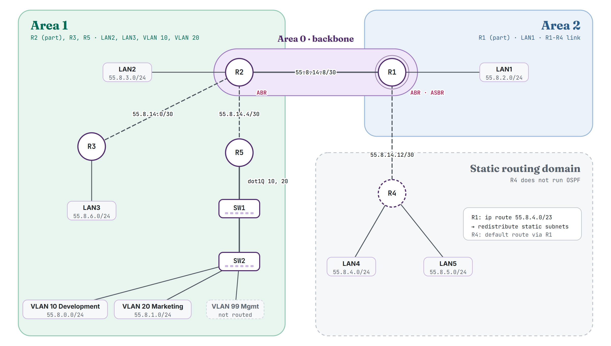
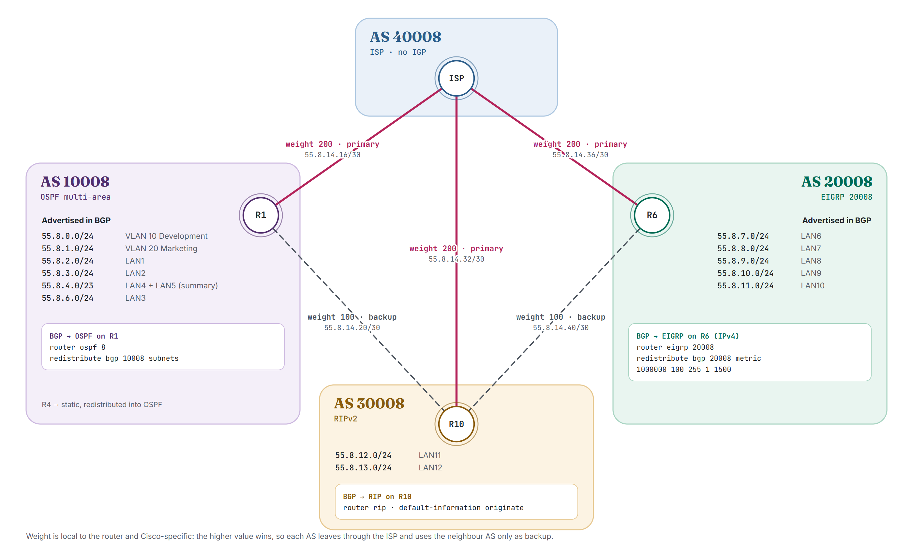

# Internet Architecture · Multi-AS Network in Cisco Packet Tracer


[](https://github.com/LazarDavidovic98/internet-architecture-project/actions/workflows/check-configs.yml)

A simulated **Internet with four autonomous systems**, built in Cisco Packet Tracer from 13 Cisco 2901 routers and 2 Cisco 2960 switches. Three customer networks and an Internet service provider each use a different routing design: **multi-area OSPF** with **802.1Q VLANs**, **dual-stack EIGRP for IPv4 and IPv6**, **RIPv2**, **static routing** for stub routers, and **eBGP** between the autonomous systems, with BGP routes redistributed into every interior protocol.

The project was the final assignment of the *Internet Architecture* course. Besides the Packet Tracer file, the repository contains the **running configuration of every device** exported from the simulation, a **20-page technical report**, a **slide deck**, and a **static checker** that tests the addressing and routing rules against the configurations on every push.

<picture>
  <source media="(prefers-color-scheme: dark)" srcset="docs/figures/topology-dark.png">
  
</picture>

| | AS 10008 | AS 20008 | AS 30008 | AS 40008 |
|---|---|---|---|---|
| Role | customer | customer | customer | ISP |
| Devices | R1–R5, SW1, SW2 | R6–R9 | R10–R12 | ISP |
| Interior routing | multi-area OSPF (areas 0, 1, 2) | EIGRP, IPv4 and IPv6 | RIPv2 | – |
| Static routing | R4 (stub) | R8 (stub, IPv4 + IPv6) | – | – |
| Address families | IPv4 | IPv4 + IPv6 | IPv4 | IPv4 |
| eBGP border router | R1 | R6 | R10 | ISP |
| User segments | LAN1–LAN5, VLAN 10, VLAN 20 | LAN6–LAN10 | LAN11, LAN12 | – |

---

## Table of contents

1. [Project overview](#project-overview)
2. [Key features](#key-features)
3. [Technology stack](#technology-stack)
4. [Network design](#network-design)
5. [Routing design](#routing-design)
6. [Verification](#verification)
7. [Project structure](#project-structure)
8. [Getting started](#getting-started)
9. [Documentation](#documentation)
10. [Implementation status and known limitations](#implementation-status-and-known-limitations)
11. [Future improvements](#future-improvements)
12. [Author](#author)

---

## Project overview

The assignment gives a topology of four autonomous systems and asks for a complete technical solution: an addressing plan, interface configuration, VLANs, five kinds of routing and the interaction between them. The constraints make the design non-trivial:

- **Address space is fixed**: the public block 55.8.0.0/16 for IPv4 and 2001:33:EF08::/48 for IPv6, and every LAN must hold up to 126 computers (VLANs up to 200).
- **IPv6 only in one AS** (AS 20008), so that AS runs every protocol twice.
- **Two routers stay out of the interior protocol** (R4 and R8). Their networks still have to be reachable, so they are injected into OSPF and EIGRP through redistribution.
- **The ISP link must be primary** and links between customer networks only a backup, and only LAN and VLAN prefixes may be announced between autonomous systems.
- **The management VLAN must stay isolated**: switches are managed only from one administrator port, and that traffic is never routed.

The result is documented task by task in the [report](docs/Report.pdf), with an explanation and a configuration excerpt for every requirement.

## Key features

- **Complete IPv4 and IPv6 addressing plan.** Subnets are sized from the host requirements (/24 per LAN and VLAN, /30 per link), with an aligned 55.8.4.0/23 block so that two LANs need a single route.
- **VLANs with router-on-a-stick.** Development (10) and Marketing (20) are routed on R5 subinterfaces, and management (99) is isolated on a private range.
- **Multi-area OSPF** with three areas, two ABRs and an ASBR that redistributes a static summary as an external route.
- **Dual-stack EIGRP.** IPv4 and IPv6 processes on R6, R7 and R9, with static routes redistributed for both address families.
- **RIPv2** with a single classful network statement.
- **eBGP design.** Five sessions with weight-based primary and backup paths, plus redistribution of BGP routes into OSPF, EIGRP (with a seed metric) and RIP (as a default route).
- **Configurations as text.** The running configuration of all 15 network devices is exported from the `.pkt` into [`configs/`](configs), together with the cabling and host tables, so you can read and diff the design without opening Packet Tracer.
- **Automated checks.** [`scripts/check_configs.py`](scripts/check_configs.py) runs 727 checks of addressing, VLANs, routing coverage and the BGP design, in GitHub Actions on every push.

## Technology stack

| Area | Used |
|---|---|
| Simulator | Cisco Packet Tracer 8.1.1 |
| Routers | Cisco 2901 (IOS 15.1) with HWIC-2T serial cards |
| Switches | Cisco 2960-24TT |
| Protocols | IPv4, IPv6, 802.1Q, OSPFv2, EIGRP (IPv4 and IPv6), RIPv2, BGP-4 |
| Checks | Python 3.12, standard library only (`ipaddress`, `csv`) |
| CI | GitHub Actions |

## Network design

### Addressing

| Segment | Size | Prefix | Why |
|---|---|---|---|
| LAN1–LAN12 | up to 126 PCs + gateway = 127 addresses | /24 | a /25 has only 126 usable addresses |
| VLAN 10, VLAN 20 | up to 200 PCs + gateway | /24 | 254 usable addresses |
| Router-to-router links | 2 addresses | /30 | 14 links carved from 55.8.14.0/24 |
| VLAN 99 (management) | switches + administrator | 192.168.0.0/24 | private and never routed |
| IPv6 segments (AS 20008) | | /64 | 2001:33:EF08:1::/64 … :8::/64, link-local FE80::*n* |

The LAN and VLAN subnets take 55.8.0.0 to 55.8.13.0 (/24 each). LAN4 and LAN5, both behind R4, sit at 55.8.4.0 and 55.8.5.0 so that together they form **55.8.4.0/23**. Routers use the first address of each LAN and test PCs the second. Everything from 55.8.15.0 up is free for growth. The full tables, with every interface, are in sections 4 and 5 of the [report](docs/Report.md#4-task-1-addressing-plan).

### VLANs behind R5

| VLAN | Purpose | Subnet | Ports on SW1 and SW2 |
|---|---|---|---|
| 10 | Development | 55.8.0.0/24 | F0/1–F0/3 |
| 20 | Marketing | 55.8.1.0/24 | F0/4–F0/6 |
| 99 | Management | 192.168.0.0/24 | F0/15 on SW2 (administrator) |

R5 routes VLAN 10 and 20 on the subinterfaces G0/1.10 and G0/1.20. VLAN 99 has no subinterface, so it can never be routed.

## Routing design

### Static routes and OSPF in AS 10008

R4 is a stub with a default route to R1. R1 holds one summary route to both of R4's LANs and redistributes it into OSPF (`redistribute static subnets`). OSPF process 8 is split into three areas:

<picture>
  <source media="(prefers-color-scheme: dark)" srcset="docs/figures/ospf-areas-dark.png">
  
</picture>

### EIGRP and RIP

- **AS 20008** runs EIGRP 20008 for IPv4 (`network` statements) and IPv6 (`ipv6 router eigrp 20008` with an explicit router ID and `ipv6 eigrp 20008` on each interface). R8 is a dual-stack stub. R7 holds its static routes and redistributes them into both EIGRP processes.
- **AS 30008** runs RIPv2 with `network 55.0.0.0`, which covers every interface because all addresses fall in one classful network.

### eBGP between the autonomous systems

<picture>
  <source media="(prefers-color-scheme: dark)" srcset="docs/figures/bgp-design-dark.png">
  
</picture>

Every customer border router peers with the ISP (**weight 200**, primary) and with its neighbouring customer AS (**weight 100**, backup), so traffic leaves through the ISP and uses another customer network only if the ISP link fails. Only LAN and VLAN prefixes are announced. The BGP routes are then redistributed into OSPF on R1, into EIGRP on R6 (`metric 1000000 100 255 1 1500`), and into RIP as a default route on R10 (`default-information originate`).

## Verification

[`scripts/check_configs.py`](scripts/check_configs.py) parses the exported configurations, [`configs/links.csv`](configs/links.csv) and [`configs/hosts.csv`](configs/hosts.csv), and checks the rules of the assignment:

- **Addressing:** addresses inside the assigned blocks, no duplicates or overlapping subnets, both ends of every cable in the same subnet, subnets large enough for the required hosts.
- **Hosts:** each PC is in its router's subnet and uses the router as its gateway.
- **VLANs:** port membership, trunks, a management address on each switch, and VLAN 99 never routed.
- **Routing:** R4 and R8 run no IGP; every internal interface is advertised and no inter-AS link is; IPv6 interfaces run EIGRP for IPv6; static next hops are connected; OSPF areas and ABRs; redistribution of static routes.
- **eBGP design:** AS numbers, neighbour addresses and remote AS numbers match the real peers, the weights match the primary and backup roles, and exactly the LAN and VLAN prefixes are announced.

```text
$ python scripts/check_configs.py
Devices: 15  links: 31  hosts: 15  BGP routers: 4
Checks passed: 727
WARNING  host LAN1 uses mask /25, router R1 GigabitEthernet0/0 uses /24
WARNING  host 'VLAN MENADZMENT' (VLAN 99 Management) has no IP address configured
WARNING  R10: 'network 55.0.0.0' also sends RIP updates out of inter-AS links Serial0/0/0, Serial0/0/1, Serial0/1/0 (no passive-interface)
OK
```

The warnings are real findings in the saved simulation and are described under [known limitations](#implementation-status-and-known-limitations). Commands for checking the network inside Packet Tracer are listed in section 14 of the [report](docs/Report.md#14-verification).

## Project structure

<!-- project-tree:start -->
<p>
<a href="https://github.com/LazarDavidovic98/internet-architecture-project" title="internet-architecture-project"></a><br>
<a href="https://github.com/LazarDavidovic98/internet-architecture-project/blob/main/src/ai-project.pkt" title="src/ai-project.pkt"></a><br>
<a href="https://github.com/LazarDavidovic98/internet-architecture-project/tree/main/configs" title="configs/"></a><br>
<a href="https://github.com/LazarDavidovic98/internet-architecture-project/tree/main/configs/as10008" title="configs/as10008/"></a><br>
<a href="https://github.com/LazarDavidovic98/internet-architecture-project/tree/main/configs/as20008" title="configs/as20008/"></a><br>
<a href="https://github.com/LazarDavidovic98/internet-architecture-project/tree/main/configs/as30008" title="configs/as30008/"></a><br>
<a href="https://github.com/LazarDavidovic98/internet-architecture-project/tree/main/configs/as40008" title="configs/as40008/"></a><br>
<a href="https://github.com/LazarDavidovic98/internet-architecture-project/tree/main/configs/bgp" title="configs/bgp/"></a><br>
<a href="https://github.com/LazarDavidovic98/internet-architecture-project/blob/main/configs/links.csv" title="configs/links.csv"></a><br>
<a href="https://github.com/LazarDavidovic98/internet-architecture-project/blob/main/configs/hosts.csv" title="configs/hosts.csv"></a><br>
<a href="https://github.com/LazarDavidovic98/internet-architecture-project/tree/main/docs" title="docs/"></a><br>
<a href="https://github.com/LazarDavidovic98/internet-architecture-project/blob/main/docs/Report.pdf" title="docs/Report.pdf"></a><br>
<a href="https://github.com/LazarDavidovic98/internet-architecture-project/blob/main/docs/Report.md" title="docs/Report.md"></a><br>
<a href="https://github.com/LazarDavidovic98/internet-architecture-project/blob/main/docs/Presentation.pdf" title="docs/Presentation.pdf"></a><br>
<a href="https://github.com/LazarDavidovic98/internet-architecture-project/tree/main/docs/figures" title="docs/figures/"></a><br>
<a href="https://github.com/LazarDavidovic98/internet-architecture-project/tree/main/scripts" title="scripts/"></a><br>
<a href="https://github.com/LazarDavidovic98/internet-architecture-project/blob/main/scripts/check_configs.py" title="scripts/check_configs.py"></a><br>
<a href="https://github.com/LazarDavidovic98/internet-architecture-project/blob/main/.github/workflows/check-configs.yml" title=".github/workflows/check-configs.yml"></a><br>
</p>

<sub>Every row is a link to that file or folder on GitHub. Purple: folders, green: source code, grey: configuration, data and docs.</sub>
<!-- project-tree:end -->

## Getting started

**Open the simulation**

1. Install [Cisco Packet Tracer](https://www.netacad.com/cisco-packet-tracer) 8.1 or newer (free with a Cisco Networking Academy account).
2. Open [`src/ai-project.pkt`](src/ai-project.pkt).
3. Click any router, open the **CLI** tab and try `show ip route`, `show ip ospf neighbor`, `show ip eigrp neighbors` or `show ipv6 route`, or ping between the test PCs (for example from LAN4 `ping 55.8.2.2`).

**Read the configurations without Packet Tracer**

Browse [`configs/`](configs): one `.cfg` file per device, grouped by autonomous system, plus the eBGP design in [`configs/bgp/`](configs/bgp).

**Run the checks**

```bash
python scripts/check_configs.py
```

This needs Python 3.8 or newer and no packages. The exit code is 0 when there are no errors.

## Documentation

| Document | Contents |
|---|---|
| [docs/Report.pdf](docs/Report.pdf) | final report, 20 pages: assignment, addressing tables, every interface, configuration excerpts and explanations for all ten tasks, verification, status |
| [docs/Report.md](docs/Report.md) | the same report in Markdown, readable on GitHub |
| [docs/Presentation.pdf](docs/Presentation.pdf) | 14-slide presentation of the design |
| [docs/figures/](docs/figures) | topology, OSPF areas and eBGP diagrams (light and dark), the assignment figure and a Packet Tracer screenshot |

## Implementation status and known limitations

| Tasks | Status in `src/ai-project.pkt` |
|---|---|
| 1–8: addressing, interfaces, VLANs, static routing, OSPF, EIGRP (IPv4/IPv6), RIPv2 | implemented |
| 9–10: eBGP and redistribution of BGP routes | designed in the report and in [`configs/bgp/`](configs/bgp), **not loaded in the saved file** |

- **No inter-AS traffic in the saved file.** Routing inside every AS works, but the ISP and the border routers have no BGP configuration in the `.pkt`. Pasting the files from [`configs/bgp/`](configs/bgp) into R1, R6, R10 and ISP completes it. Leave out the `weight` lines: Packet Tracer does not support them, and the assignment only requires them to be documented.
- **Remote switch management is not finished.** The administrator PC on SW2 F0/15 has no IP address, and the switch VTY lines have `login` but no password.
- **LAN1 test PC** uses mask 255.255.255.128 instead of /24. It still works, because the PC and its gateway are in the same /25.
- **No passive interfaces.** R10 sends RIP updates on its three inter-AS links, and R1 sends OSPF hellos towards R4.

## Future improvements

- Load the eBGP configuration into the `.pkt` and add a ping/traceroute matrix between all LANs.
- Finish the management VLAN: address the administrator PC and enable SSH with local users on both switches.
- Add `passive-interface` on stub and inter-AS links, and set the LAN1 PC mask to /24.
- Replace the weight-based policy with `local-preference` (route maps), which is vendor-neutral and applies to the whole AS.
- Add OSPFv3 and an IPv6 eBGP session to make the dual-stack design end to end.

## Author

**Lazar Davidović**, final project of the *Internet Architecture* course. The original report (June 2025) was revised and translated into English in November 2026.
