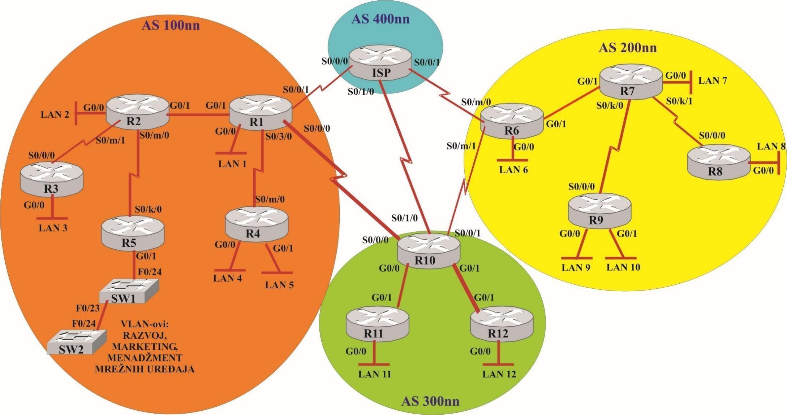
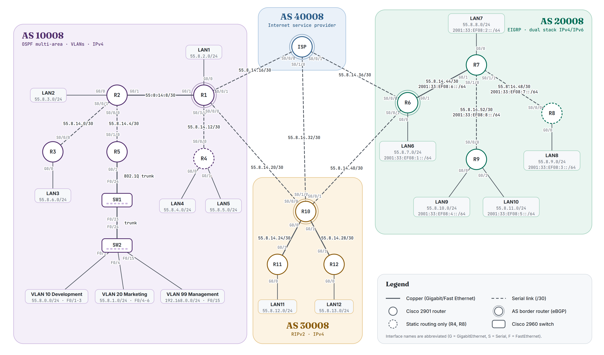
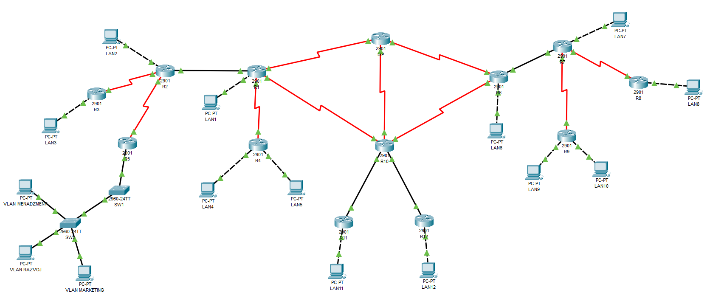
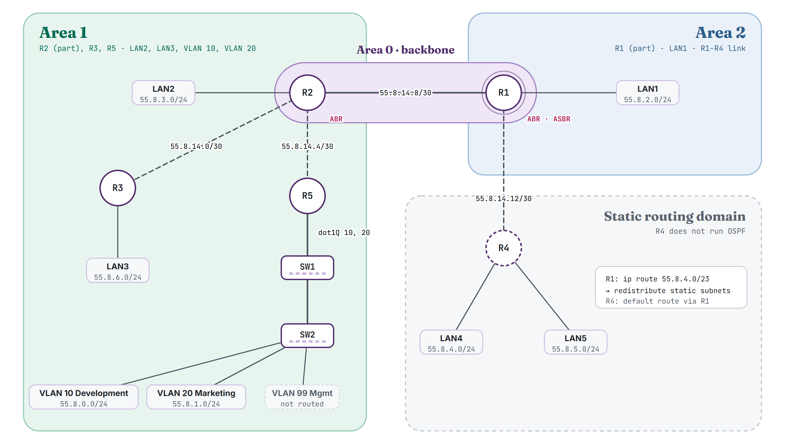
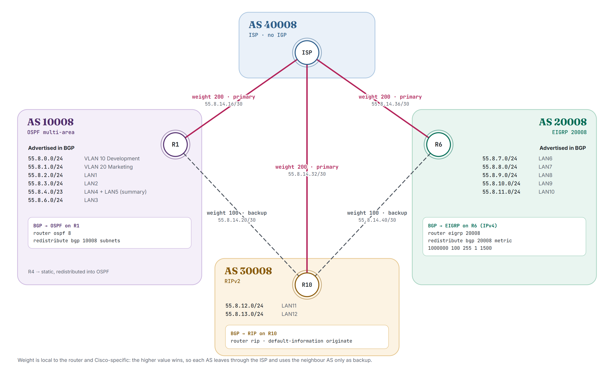

# Internet Architecture: Final Project Report

**Multi-AS network design in Cisco Packet Tracer: addressing, VLANs, static routing, OSPF, EIGRP, RIPv2 and eBGP**

Lazar Davidović · Cisco Packet Tracer 8.1.1 · assignment variant *nn* = 08

---

## Contents

1. [Summary](#1-summary)
2. [Assignment](#2-assignment)
3. [Topology and equipment](#3-topology-and-equipment)
4. [Task 1: Addressing plan](#4-task-1-addressing-plan)
5. [Task 2: Interfaces and IP parameters](#5-task-2-interfaces-and-ip-parameters)
6. [Task 3: VLANs on the R5 LAN segment](#6-task-3-vlans-on-the-r5-lan-segment)
7. [Task 4: Static routing for R4](#7-task-4-static-routing-for-r4)
8. [Task 5: Multi-area OSPF in AS 10008](#8-task-5-multi-area-ospf-in-as-10008)
9. [Task 6: Static routing for R8 (IPv4 and IPv6)](#9-task-6-static-routing-for-r8-ipv4-and-ipv6)
10. [Task 7: Dual-stack EIGRP in AS 20008](#10-task-7-dual-stack-eigrp-in-as-20008)
11. [Task 8: RIPv2 in AS 30008](#11-task-8-ripv2-in-as-30008)
12. [Task 9: External routing with eBGP](#12-task-9-external-routing-with-ebgp)
13. [Task 10: Redistribution of BGP routes](#13-task-10-redistribution-of-bgp-routes)
14. [Verification](#14-verification)
15. [Implementation status and known issues](#15-implementation-status-and-known-issues)
16. [Appendix: corrections to the 2025 report](#16-appendix-corrections-to-the-2025-report)

---

## 1. Summary

The project designs and simulates a small Internet: three customer autonomous systems and one Internet service provider, connected by 13 Cisco 2901 routers and 2 Cisco 2960 switches. Each autonomous system uses a different interior routing protocol, the edges of two of them use static routing, one LAN segment is split into VLANs, and the systems exchange routes with each other over eBGP.

| | AS 10008 | AS 20008 | AS 30008 | AS 40008 |
|---|---|---|---|---|
| Role | customer | customer | customer | Internet service provider |
| Routers | R1–R5 (+ SW1, SW2) | R6–R9 | R10–R12 | ISP |
| Interior routing | multi-area OSPF (areas 0, 1, 2) | EIGRP for IPv4 and IPv6 | RIPv2 | none |
| Static routing | R4 (stub) | R8 (stub, IPv4 + IPv6) | – | – |
| Address families | IPv4 | IPv4 + IPv6 | IPv4 | IPv4 |
| Border router (eBGP) | R1 | R6 | R10 | ISP |
| Extra | 3 VLANs behind R5 | – | – | – |

The address space is the public block **55.8.0.0/16** for IPv4 and **2001:33:EF08::/48** for IPv6. The management VLAN uses the private range **192.168.0.0/24**.

The full running configuration of every device was exported from the Packet Tracer file into [`configs/`](../configs), and the excerpts in this report are copied from those files. A static checker, [`scripts/check_configs.py`](../scripts/check_configs.py), checks the addressing and routing rules of the assignment against them (section 14).

## 2. Assignment

The topology in Figure 1 has to be connected, addressed and routed. The autonomous system numbers are 100*nn*, 200*nn*, 300*nn* and 400*nn* (the ISP). For this variant *nn* = 08, so the AS numbers are **10008, 20008, 30008 and 40008**, the IPv4 block is 55.*nn*.0.0/16 and the IPv6 routing prefix is 2001:33:EF*nn*::/48. The devices are Cisco 2901 routers and Cisco 2960 switches in Cisco Packet Tracer.

| Task | Requirement |
|---|---|
| 1 | Addressing plan for the whole network. IPv4 only in AS 10008, AS 30008 and AS 40008; IPv4 and IPv6 in AS 20008. Every LAN must hold 70–126 computers; the Development and Marketing VLANs up to 200 each. The management VLAN uses a private range. |
| 2 | Define all router and switch interfaces and assign IP parameters. |
| 3 | Three VLANs behind R5: Development, Marketing and device management. Routing between Development and Marketing; remote access to the switches only through the management VLAN, from the administrator PC on SW2 port 15; management traffic is not routed. Ports 1–3 in Development and 4–6 in Marketing on both switches. |
| 4 | R4 does not run the interior protocol of AS 10008; use static routes. |
| 5 | Multi-area OSPF in AS 10008 with three areas, shown in a diagram. The routes to LAN 4 and LAN 5 behind R4 must be redistributed into OSPF. |
| 6 | R8 does not run the interior protocol of AS 20008; use static routes for IPv4 and IPv6. |
| 7 | EIGRP for IPv4 and IPv6 in AS 20008, with the route to LAN 8 redistributed for both families. |
| 8 | RIPv2 in AS 30008. |
| 9 | An exterior routing protocol between AS 10008, AS 20008, AS 30008 and the ISP. The link to the ISP is primary and links to other customer ASes are backup (the primary-link commands cannot be run in the simulator and are only listed). Only the LAN and VLAN networks are advertised. IPv4 only. |
| 10 | Redistribute the routes learned through the exterior protocol into the interior protocols of AS 10008, AS 20008 and AS 30008. |

<p align="center"></p>
<p align="center"><em>Figure 1. Topology given in the assignment (interface positions marked m/k were free to choose).</em></p>

## 3. Topology and equipment

<picture>
  <source media="(prefers-color-scheme: dark)" srcset="figures/topology-dark.png">
  
</picture>
<p align="center"><em>Figure 2. Implemented topology, redrawn from the Packet Tracer file, with every subnet and interface.</em></p>

| Device | Model | Count | Notes |
|---|---|---|---|
| Router | Cisco 2901 | 13 | R1–R12 and ISP; serial links use HWIC-2T cards |
| Switch | Cisco 2960-24TT | 2 | SW1, SW2 |
| End host | PC-PT | 15 | one test PC per LAN and VLAN, plus the administrator PC |
| Links | | 31 | 10 serial (/30) and 21 copper |

The exact cabling, including which side of every serial link provides the clock (DCE), is in [`configs/links.csv`](../configs/links.csv). Host addresses are in [`configs/hosts.csv`](../configs/hosts.csv).

<p align="center"></p>
<p align="center"><em>Figure 3. The logical workspace in Packet Tracer.</em></p>

## 4. Task 1: Addressing plan

### Sizing

| Segment type | Requirement | Addresses needed | Host bits | Prefix | Usable addresses |
|---|---|---|---|---|---|
| LAN1–LAN12 | up to 126 computers + router interface | 127 | 8 | /24 | 254 |
| VLAN 10, VLAN 20 | up to 200 computers + router subinterface | 201 | 8 | /24 | 254 |
| Router-to-router link | two interfaces | 2 | 2 | /30 | 2 |
| VLAN 99 (management) | two switches + administrator PC | 3 | private range | /24 | 254 |

A /25 has 126 usable addresses. That is exactly the maximum number of computers, but it leaves nothing for the router interface, so every LAN needs a /24. The VLANs fit in a /24 as well.

### IPv4

The LAN and VLAN subnets take the first fifteen /24 blocks of 55.8.0.0/16. All point-to-point links are /30 subnets carved from 55.8.14.0/24. LAN4 and LAN5, both behind R4, are placed at 55.8.4.0/24 and 55.8.5.0/24 on purpose: together they form the aligned block **55.8.4.0/23**, so one static route and one BGP announcement cover both. This is why LAN3 is at 55.8.6.0/24.

| # | Network | Mask | Segment | AS | Gateway |
|---|---|---|---|---|---|
| 1 | 192.168.0.0/24 | 255.255.255.0 | VLAN 99 Management (private) | 10008 | not routed |
| 2 | 55.8.0.0/24 | 255.255.255.0 | VLAN 10 Development | 10008 | R5 G0/1.10 |
| 3 | 55.8.1.0/24 | 255.255.255.0 | VLAN 20 Marketing | 10008 | R5 G0/1.20 |
| 4 | 55.8.2.0/24 | 255.255.255.0 | LAN1 | 10008 | R1 G0/0 |
| 5 | 55.8.3.0/24 | 255.255.255.0 | LAN2 | 10008 | R2 G0/0 |
| 6 | 55.8.4.0/24 | 255.255.255.0 | LAN4 | 10008 | R4 G0/0 |
| 7 | 55.8.5.0/24 | 255.255.255.0 | LAN5 | 10008 | R4 G0/1 |
| 8 | 55.8.6.0/24 | 255.255.255.0 | LAN3 | 10008 | R3 G0/0 |
| 9 | 55.8.7.0/24 | 255.255.255.0 | LAN6 | 20008 | R6 G0/0 |
| 10 | 55.8.8.0/24 | 255.255.255.0 | LAN7 | 20008 | R7 G0/0 |
| 11 | 55.8.9.0/24 | 255.255.255.0 | LAN8 | 20008 | R8 G0/0 |
| 12 | 55.8.10.0/24 | 255.255.255.0 | LAN9 | 20008 | R9 G0/0 |
| 13 | 55.8.11.0/24 | 255.255.255.0 | LAN10 | 20008 | R9 G0/1 |
| 14 | 55.8.12.0/24 | 255.255.255.0 | LAN11 | 30008 | R11 G0/0 |
| 15 | 55.8.13.0/24 | 255.255.255.0 | LAN12 | 30008 | R12 G0/0 |
| 16 | 55.8.14.0/30 | 255.255.255.252 | R2 – R3 | 10008 | |
| 17 | 55.8.14.4/30 | 255.255.255.252 | R2 – R5 | 10008 | |
| 18 | 55.8.14.8/30 | 255.255.255.252 | R1 – R2 | 10008 | |
| 19 | 55.8.14.12/30 | 255.255.255.252 | R1 – R4 | 10008 | |
| 20 | 55.8.14.16/30 | 255.255.255.252 | R1 – ISP | inter-AS | |
| 21 | 55.8.14.20/30 | 255.255.255.252 | R1 – R10 | inter-AS | |
| 22 | 55.8.14.24/30 | 255.255.255.252 | R10 – R11 | 30008 | |
| 23 | 55.8.14.28/30 | 255.255.255.252 | R10 – R12 | 30008 | |
| 24 | 55.8.14.32/30 | 255.255.255.252 | ISP – R10 | inter-AS | |
| 25 | 55.8.14.36/30 | 255.255.255.252 | ISP – R6 | inter-AS | |
| 26 | 55.8.14.40/30 | 255.255.255.252 | R6 – R10 | inter-AS | |
| 27 | 55.8.14.44/30 | 255.255.255.252 | R6 – R7 | 20008 | |
| 28 | 55.8.14.48/30 | 255.255.255.252 | R7 – R8 | 20008 | |
| 29 | 55.8.14.52/30 | 255.255.255.252 | R7 – R9 | 20008 | |

The plan uses 55.8.0.0 – 55.8.14.55. The rest of 55.8.14.0/24 and the blocks 55.8.15.0 – 55.8.255.255 stay free for growth.

### IPv6 (AS 20008 only)

Each segment gets a /64 from 2001:33:EF08::/48. The 16-bit subnet ID is simply a sequence number, so the prefixes are easy to read. Point-to-point links also use /64, which keeps the plan uniform. Every router interface also gets a fixed link-local address **FE80::*n***, where *n* is the router number (FE80::6 on R6 up to FE80::9 on R9). This makes next hops and neighbour tables easy to read.

| # | Prefix | Segment |
|---|---|---|
| 1 | 2001:33:EF08:1::/64 | LAN6 |
| 2 | 2001:33:EF08:2::/64 | LAN7 |
| 3 | 2001:33:EF08:3::/64 | LAN8 |
| 4 | 2001:33:EF08:4::/64 | LAN9 |
| 5 | 2001:33:EF08:5::/64 | LAN10 |
| 6 | 2001:33:EF08:6::/64 | R6 – R7 |
| 7 | 2001:33:EF08:7::/64 | R7 – R8 |
| 8 | 2001:33:EF08:8::/64 | R7 – R9 |

**Host convention.** In every LAN the router uses the first address (.1 / ::1) and the test PC the second (.2 / ::2) with the router as its default gateway.

## 5. Task 2: Interfaces and IP parameters

R5 has one physical interface towards the switches, but it has to serve two routed VLANs. Its interface G0/1 is therefore split into the subinterfaces G0/1.10 and G0/1.20 (router-on-a-stick). The table below is generated from the exported running configurations. Interfaces without an address are shut down and left out.

| Device | Interface | IPv4 address | IPv6 address | Connected to |
|---|---|---|---|---|
| **R1** | G0/0 | `55.8.2.1/24` | – | LAN1 |
|  | G0/1 | `55.8.14.9/30` | – | R2 G0/1 |
|  | S0/0/0 | `55.8.14.21/30` | – | R10 S0/0/0 |
|  | S0/0/1 | `55.8.14.17/30` | – | ISP S0/0/0 |
|  | S0/3/0 | `55.8.14.13/30` | – | R4 S0/0/0 |
| **R2** | G0/0 | `55.8.3.1/24` | – | LAN2 |
|  | G0/1 | `55.8.14.10/30` | – | R1 G0/1 |
|  | S0/0/0 | `55.8.14.5/30` | – | R5 S0/1/0 |
|  | S0/0/1 | `55.8.14.1/30` | – | R3 S0/0/0 |
| **R3** | G0/0 | `55.8.6.1/24` | – | LAN3 |
|  | S0/0/0 | `55.8.14.2/30` | – | R2 S0/0/1 |
| **R4** | G0/0 | `55.8.4.1/24` | – | LAN4 |
|  | G0/1 | `55.8.5.1/24` | – | LAN5 |
|  | S0/0/0 | `55.8.14.14/30` | – | R1 S0/3/0 |
| **R5** | G0/1.10 | `55.8.0.1/24` | – | SW1 F0/24 (dot1Q 10) |
|  | G0/1.20 | `55.8.1.1/24` | – | SW1 F0/24 (dot1Q 20) |
|  | S0/1/0 | `55.8.14.6/30` | – | R2 S0/0/0 |
| **R6** | G0/0 | `55.8.7.1/24` | `2001:33:EF08:1::1/64` | LAN6 |
|  | G0/1 | `55.8.14.45/30` | `2001:33:EF08:6::1/64` | R7 G0/1 |
|  | S0/0/0 | `55.8.14.37/30` | – | ISP S0/0/1 |
|  | S0/0/1 | `55.8.14.41/30` | – | R10 S0/0/1 |
| **R7** | G0/0 | `55.8.8.1/24` | `2001:33:EF08:2::1/64` | LAN7 |
|  | G0/1 | `55.8.14.46/30` | `2001:33:EF08:6::2/64` | R6 G0/1 |
|  | S0/1/0 | `55.8.14.53/30` | `2001:33:EF08:8::1/64` | R9 S0/0/0 |
|  | S0/1/1 | `55.8.14.49/30` | `2001:33:EF08:7::1/64` | R8 S0/0/0 |
| **R8** | G0/0 | `55.8.9.1/24` | `2001:33:EF08:3::1/64` | LAN8 |
|  | S0/0/0 | `55.8.14.50/30` | `2001:33:EF08:7::2/64` | R7 S0/1/1 |
| **R9** | G0/0 | `55.8.10.1/24` | `2001:33:EF08:4::1/64` | LAN9 |
|  | G0/1 | `55.8.11.1/24` | `2001:33:EF08:5::1/64` | LAN10 |
|  | S0/0/0 | `55.8.14.54/30` | `2001:33:EF08:8::2/64` | R7 S0/1/0 |
| **R10** | G0/0 | `55.8.14.25/30` | – | R11 G0/1 |
|  | G0/1 | `55.8.14.29/30` | – | R12 G0/1 |
|  | S0/0/0 | `55.8.14.22/30` | – | R1 S0/0/0 |
|  | S0/0/1 | `55.8.14.42/30` | – | R6 S0/0/1 |
|  | S0/1/0 | `55.8.14.33/30` | – | ISP S0/1/0 |
| **R11** | G0/0 | `55.8.12.1/24` | – | LAN11 |
|  | G0/1 | `55.8.14.26/30` | – | R10 G0/0 |
| **R12** | G0/0 | `55.8.13.1/24` | – | LAN12 |
|  | G0/1 | `55.8.14.30/30` | – | R10 G0/1 |
| **ISP** | S0/0/0 | `55.8.14.18/30` | – | R1 S0/0/1 |
|  | S0/0/1 | `55.8.14.38/30` | – | R6 S0/0/0 |
|  | S0/1/0 | `55.8.14.34/30` | – | R10 S0/1/0 |
| **SW1** | Vlan99 | `192.168.0.1/24` | – | management VLAN 99 |
| **SW2** | Vlan99 | `192.168.0.2/24` | – | management VLAN 99 |

All IPv6 interfaces also have the link-local address FE80::*n* described in section 4. On every serial link the DCE side (`clock rate 2000000`) is listed in [`configs/links.csv`](../configs/links.csv).

## 6. Task 3: VLANs on the R5 LAN segment

| VLAN | Name in the configuration | Purpose | Subnet | Access ports |
|---|---|---|---|---|
| 10 | `RAZVOJ` | Development | 55.8.0.0/24 | F0/1–F0/3 on SW1 and SW2 |
| 20 | `MARKETING` | Marketing | 55.8.1.0/24 | F0/4–F0/6 on SW1 and SW2 |
| 99 | `MENADZMENT` | Device management | 192.168.0.0/24 | F0/15 on SW2 (administrator) |

The VLAN names were entered in Serbian (*razvoj* means development, *menadžment* means management). The trunks are R5 G0/1 – SW1 F0/24 and SW1 F0/23 – SW2 F0/24.

**Inter-VLAN routing** uses router-on-a-stick. R5 has a subinterface with 802.1Q encapsulation for VLAN 10 and VLAN 20 only:

```
interface GigabitEthernet0/1.10
 encapsulation dot1Q 10
 ip address 55.8.0.1 255.255.255.0
!
interface GigabitEthernet0/1.20
 encapsulation dot1Q 20
 ip address 55.8.1.1 255.255.255.0
```

**Isolating the management VLAN.** R5 has no subinterface for VLAN 99, so frames from that VLAN never reach a routed interface. The management subnet is a private range that is not advertised anywhere. Only devices in VLAN 99 can reach the switch management addresses (SW1 192.168.0.1, SW2 192.168.0.2), and management traffic cannot leave the VLAN.

**Switch ports** (SW2; SW1 is the same apart from the administrator port and its two trunks F0/23–F0/24):

```
interface FastEthernet0/1
 switchport access vlan 10
 switchport mode access
!  (F0/2 and F0/3 identical)
interface FastEthernet0/4
 switchport access vlan 20
 switchport mode access
!  (F0/5 and F0/6 identical)
interface FastEthernet0/15
 switchport access vlan 99
 switchport mode access
!
interface FastEthernet0/24
 switchport mode trunk
!
interface Vlan99
 ip address 192.168.0.2 255.255.255.0
```

> **Not finished in the saved file.** The administrator PC has no IP address, and the switches have `login` on their VTY lines but no password. Remote access therefore does not work yet. Completing it takes `ip address 192.168.0.10 255.255.255.0` on the administrator PC and, on both switches, `enable secret <secret>`, `line vty 0 15`, `password <password>`, `login` (or local users with SSH).

## 7. Task 4: Static routing for R4

R4 is a stub router: its only path to the rest of the network goes through R1. It therefore needs just a **default route** towards R1. R1 has a single **summary route** to both of R4's LANs (55.8.4.0/23 = LAN4 + LAN5), which it then redistributes into OSPF (task 5).

```
! R4
ip route 0.0.0.0 0.0.0.0 55.8.14.13
! R1
ip route 55.8.4.0 255.255.254.0 55.8.14.14
```

## 8. Task 5: Multi-area OSPF in AS 10008

<picture>
  <source media="(prefers-color-scheme: dark)" srcset="figures/ospf-areas-dark.png">
  
</picture>
<p align="center"><em>Figure 4. OSPF areas in AS 10008.</em></p>

| Area | Contents | Routers |
|---|---|---|
| 0 (backbone) | R1 – R2 link 55.8.14.8/30 | R1, R2 |
| 1 | LAN2, LAN3, VLAN 10, VLAN 20, links R2 – R3 and R2 – R5 | R2, R3, R5 |
| 2 | LAN1, link R1 – R4 | R1 |

OSPF runs as process 8 with readable router IDs (1.1.1.1, 2.2.2.2, 3.3.3.3, 5.5.5.5). **R2** and **R1** are area border routers (ABRs): each connects a non-backbone area to area 0. **R1** is also an autonomous system boundary router (ASBR). It redistributes the static summary to R4's LANs, so the rest of the AS learns 55.8.4.0/23 as an external route (O E2). The `subnets` keyword is required, because without it IOS redistributes only classful networks.

```
! R1
router ospf 8
 router-id 1.1.1.1
 redistribute static subnets
 network 55.8.14.8 0.0.0.3 area 0
 network 55.8.2.0 0.0.0.255 area 2
 network 55.8.14.12 0.0.0.3 area 2
! R2
router ospf 8
 router-id 2.2.2.2
 network 55.8.3.0 0.0.0.255 area 1
 network 55.8.14.0 0.0.0.3 area 1
 network 55.8.14.4 0.0.0.3 area 1
 network 55.8.14.8 0.0.0.3 area 0
! R3
router ospf 8
 router-id 3.3.3.3
 network 55.8.6.0 0.0.0.255 area 1
 network 55.8.14.0 0.0.0.3 area 1
! R5
router ospf 8
 router-id 5.5.5.5
 network 55.8.0.0 0.0.0.255 area 1
 network 55.8.1.0 0.0.0.255 area 1
 network 55.8.14.4 0.0.0.3 area 1
```

The links to other autonomous systems (R1 – ISP, R1 – R10) are not in any `network` statement, so OSPF never forms adjacencies across AS boundaries.

## 9. Task 6: Static routing for R8 (IPv4 and IPv6)

R8 is the IPv4/IPv6 counterpart of R4: a stub behind R7. It has a default route for each address family, and R7 has a specific route back to LAN8 for each family.

```
! R8
ip route 0.0.0.0 0.0.0.0 55.8.14.49
ipv6 route ::/0 2001:33:EF08:7::1
! R7
ip route 55.8.9.0 255.255.255.0 55.8.14.50
ipv6 route 2001:33:EF08:3::/64 2001:33:EF08:7::2
```

## 10. Task 7: Dual-stack EIGRP in AS 20008

EIGRP runs as AS 20008 on R6, R7 and R9, for both IPv4 and IPv6.

- **IPv4** is enabled with `network` statements. R6 advertises only LAN6 and its link to R7; its links to the ISP and to R10 stay outside EIGRP.
- **IPv6** needs `ipv6 unicast-routing`, the process `ipv6 router eigrp 20008` with an explicit 32-bit `eigrp router-id` (an IPv6-only process cannot derive one), and `no shutdown`, because the IPv6 process starts shut down. Each interface then joins with `ipv6 eigrp 20008`.
- **LAN 8** is reached through R7's static routes. R7 redistributes them with `redistribute static` in both processes, so R6 and R9 see 55.8.9.0/24 and 2001:33:EF08:3::/64 as external EIGRP routes (D EX, administrative distance 170).

```
! R7 (R6 and R9 are analogous, without redistribution)
ipv6 unicast-routing
!
interface GigabitEthernet0/1
 ip address 55.8.14.46 255.255.255.252
 ipv6 address FE80::7 link-local
 ipv6 address 2001:33:EF08:6::2/64
 ipv6 eigrp 20008
!
router eigrp 20008
 eigrp router-id 7.7.7.7
 redistribute static
 network 55.8.8.0 0.0.0.255
 network 55.8.14.44 0.0.0.3
 network 55.8.14.48 0.0.0.3
 network 55.8.14.52 0.0.0.3
!
ipv6 router eigrp 20008
 eigrp router-id 7.7.7.7
 no shutdown
 redistribute static
```

```
! R6
router eigrp 20008
 eigrp router-id 6.6.6.6
 network 55.8.7.0 0.0.0.255
 network 55.8.14.44 0.0.0.3
ipv6 router eigrp 20008
 eigrp router-id 6.6.6.6
 no shutdown
! R9
router eigrp 20008
 eigrp router-id 9.9.9.9
 network 55.8.10.0 0.0.0.255
 network 55.8.11.0 0.0.0.255
 network 55.8.14.52 0.0.0.3
ipv6 router eigrp 20008
 eigrp router-id 9.9.9.9
 no shutdown
```

## 11. Task 8: RIPv2 in AS 30008

RIP version 2 runs on R10, R11 and R12. RIP `network` statements are classful, and every address in the AS belongs to the classful network 55.0.0.0/8, so a single statement enables RIP on all interfaces. Auto-summarisation has no effect here for the same reason.

```
! R10, R11 and R12
router rip
 version 2
 network 55.0.0.0
```

On R10 this statement also covers the three links to other autonomous systems (towards R1, R6 and the ISP), so R10 sends RIP updates out of them. No neighbour there runs RIP, so routing is not affected, but the cleaner configuration is `passive-interface Serial0/0/0`, `Serial0/0/1` and `Serial0/1/0` under `router rip`.

## 12. Task 9: External routing with eBGP

<picture>
  <source media="(prefers-color-scheme: dark)" srcset="figures/bgp-design-dark.png">
  
</picture>
<p align="center"><em>Figure 5. eBGP sessions, path preference and redistribution.</em></p>

Each autonomous system has exactly one border router (R1, R6, R10 and ISP), so plain eBGP is enough. iBGP is not needed.

| Session | Subnet | Local → neighbour | Role | Weight |
|---|---|---|---|---|
| R1 – ISP | 55.8.14.16/30 | 10008 → 40008 | primary | 200 |
| R1 – R10 | 55.8.14.20/30 | 10008 → 30008 | backup | 100 |
| R6 – ISP | 55.8.14.36/30 | 20008 → 40008 | primary | 200 |
| R6 – R10 | 55.8.14.40/30 | 20008 → 30008 | backup | 100 |
| R10 – ISP | 55.8.14.32/30 | 30008 → 40008 | primary | 200 |
| R10 – R1, R10 – R6 | | 30008 → 10008 / 20008 | backup | 100 |

**Primary and backup links.** The weight attribute is Cisco-specific and local to the router: when a router learns the same prefix from several neighbours, the path with the higher weight wins. Weight 200 on the ISP session and 100 on sessions with other customer ASes makes every border router send traffic through the ISP. The neighbouring AS is used only when the ISP link fails. Packet Tracer does not support `neighbor … weight`, so as the assignment allows, these commands are listed here and in [`configs/bgp/`](../configs/bgp). A vendor-neutral alternative would set `local-preference` with a route map, which also spreads the preference to other routers in the AS.

**Advertised networks.** Only LAN and VLAN networks are announced, never point-to-point links. A BGP `network` statement announces a prefix only if exactly that prefix is already in the routing table: R1 learns the area 1 and area 2 networks from OSPF and has the 55.8.4.0/23 summary as a static route, R6 learns its LANs from EIGRP, and R10 learns LAN11 and LAN12 from RIP.

```
! R1, AS 10008
router bgp 10008
 bgp log-neighbor-changes
 neighbor 55.8.14.18 remote-as 40008
 neighbor 55.8.14.18 weight 200
 neighbor 55.8.14.22 remote-as 30008
 neighbor 55.8.14.22 weight 100
 network 55.8.0.0 mask 255.255.255.0
 network 55.8.1.0 mask 255.255.255.0
 network 55.8.2.0 mask 255.255.255.0
 network 55.8.3.0 mask 255.255.255.0
 network 55.8.4.0 mask 255.255.254.0
 network 55.8.6.0 mask 255.255.255.0
```

```
! R6, AS 20008
router bgp 20008
 bgp log-neighbor-changes
 no synchronization
 neighbor 55.8.14.38 remote-as 40008
 neighbor 55.8.14.38 weight 200
 neighbor 55.8.14.42 remote-as 30008
 neighbor 55.8.14.42 weight 100
 network 55.8.7.0 mask 255.255.255.0
 network 55.8.8.0 mask 255.255.255.0
 network 55.8.9.0 mask 255.255.255.0
 network 55.8.10.0 mask 255.255.255.0
 network 55.8.11.0 mask 255.255.255.0
```

```
! R10, AS 30008
router bgp 30008
 bgp log-neighbor-changes
 no synchronization
 neighbor 55.8.14.21 remote-as 10008
 neighbor 55.8.14.21 weight 100
 neighbor 55.8.14.34 remote-as 40008
 neighbor 55.8.14.34 weight 200
 neighbor 55.8.14.41 remote-as 20008
 neighbor 55.8.14.41 weight 100
 network 55.8.12.0 mask 255.255.255.0
 network 55.8.13.0 mask 255.255.255.0
```

```
! ISP, AS 40008
router bgp 40008
 bgp log-neighbor-changes
 no synchronization
 neighbor 55.8.14.17 remote-as 10008
 neighbor 55.8.14.33 remote-as 30008
 neighbor 55.8.14.37 remote-as 20008
```

## 13. Task 10: Redistribution of BGP routes

The border routers inject the BGP routes into their interior protocol, so every router in the AS can reach the other autonomous systems.

| Border router | Into | Command | Notes |
|---|---|---|---|
| R1 | OSPF 8 | `redistribute bgp 10008 subnets` | appear as O E2 routes; `subnets` keeps the /24 and /23 prefixes |
| R6 | EIGRP 20008 (IPv4) | `redistribute bgp 20008 metric 1000000 100 255 1 1500` | EIGRP needs a seed metric for external routes: bandwidth 1,000,000 kbit/s, delay 100 × 10 µs, reliability 255/255, load 1/255, MTU 1500 |
| R10 | RIPv2 | `default-information originate` | R11 and R12 get a default route to R10, which holds the full BGP table; this is simpler than redistributing every prefix into RIP |

```
! R1
router ospf 8
 redistribute bgp 10008 subnets
! R6
router eigrp 20008
 redistribute bgp 20008 metric 1000000 100 255 1 1500
! R10
router rip
 default-information originate
```

## 14. Verification

### Static checks

[`scripts/check_configs.py`](../scripts/check_configs.py) reads the exported configurations, the cabling table and the host table, and checks the rules of the assignment. It needs only the Python standard library and runs on every push through GitHub Actions.

| Group | What is checked |
|---|---|
| Addressing | every address is inside 55.8.0.0/16, 2001:33:EF08::/48 or the management range; no duplicates; no overlapping subnets; both ends of every cable in the same subnet; serial links are /30; LAN and VLAN subnets are large enough for the required hosts |
| Hosts | every PC uses its router as the gateway and is inside the router's subnet |
| VLANs | R5 routes VLAN 10 and 20 only; ports 1–3 and 4–6 on both switches; SW2 F0/15 in VLAN 99; both switches have a management address |
| Routing | R4 and R8 run no IGP and have static routes; every internal interface is advertised by the AS's IGP and no inter-AS link is; IPv6 interfaces in AS 20008 run EIGRP for IPv6; static next hops are directly connected; OSPF has areas 0, 1 and 2 with ABRs; redistribution of static routes on R1 and R7 |
| eBGP design | local AS numbers, neighbour addresses and remote AS numbers match the real peers; weights 200 / 100; every LAN and VLAN is advertised, and nothing else |

Result on the current configuration:

```
$ python scripts/check_configs.py
Devices: 15  links: 31  hosts: 15  BGP routers: 4
Checks passed: 727
WARNING  host LAN1 uses mask /25, router R1 GigabitEthernet0/0 uses /24
WARNING  host 'VLAN MENADZMENT' (VLAN 99 Management) has no IP address configured
WARNING  R10: 'network 55.0.0.0' also sends RIP updates out of inter-AS links Serial0/0/0, Serial0/0/1, Serial0/1/0 (no passive-interface)
OK
```

The warnings are discussed in section 15.

### Checks in the simulator

| Goal | Command | Expected result |
|---|---|---|
| Interfaces up | `show ip interface brief`, `show ipv6 interface brief` | every addressed interface *up/up* |
| VLANs and trunks | `show vlan brief`, `show interfaces trunk` (SW1, SW2) | ports 1–3 in VLAN 10, 4–6 in VLAN 20, F0/15 in VLAN 99 |
| OSPF | `show ip ospf neighbor`, `show ip route ospf` (R1–R3, R5) | adjacencies R1–R2, R2–R3, R2–R5; `O IA` routes between areas; `O E2 55.8.4.0/23` |
| EIGRP | `show ip eigrp neighbors`, `show ipv6 eigrp neighbors`, `show ipv6 route` (R6, R7, R9) | neighbours over IPv4 and IPv6; `EX 2001:33:EF08:3::/64` from R7 |
| RIP | `show ip route rip` (R10–R12) | `R` routes to LAN11 and LAN12 |
| Static stubs | `ping 55.8.2.2` from LAN4; `ping 2001:33:EF08:1::2` from LAN8 | replies through R1 and R7 |
| Inter-VLAN | `ping 55.8.1.2` from the VLAN 10 PC | replies through R5 |
| eBGP (design) | `show ip bgp summary`, `show ip bgp` | three sessions on the ISP, two on each customer border router |

## 15. Implementation status and known issues

| Task | Status in `src/ai-project.pkt` |
|---|---|
| 1–2 Addressing and interfaces | implemented |
| 3 VLANs and inter-VLAN routing | implemented; remote management not finished (see below) |
| 4 Static routing R4 | implemented |
| 5 Multi-area OSPF | implemented |
| 6 Static routing R8 (IPv4/IPv6) | implemented |
| 7 Dual-stack EIGRP | implemented |
| 8 RIPv2 | implemented |
| 9 eBGP | **designed in this report and in [`configs/bgp/`](../configs/bgp), not loaded in the saved file** |
| 10 Redistribution of BGP routes | **designed, not loaded in the saved file** |

Known issues in the saved simulation:

- **eBGP is not configured in the `.pkt` file.** Routing inside each AS works, but the ISP router has no routing configuration, so traffic between autonomous systems does not flow in the saved file. Pasting [`configs/bgp/`](../configs/bgp) into R1, R6, R10 and ISP (without the `weight` lines, which Packet Tracer rejects) completes tasks 9 and 10.
- **Administrator PC and VTY passwords** are not configured (section 6), so remote management of the switches does not work yet.
- **LAN1 test PC mask.** The PC uses 255.255.255.128 while R1 uses /24. It still reaches its gateway, because 55.8.2.2 and 55.8.2.1 are in the same /25, but the mask should be 255.255.255.0.
- **RIP on inter-AS links.** R10 sends RIP updates towards R1, R6 and ISP (section 11); add `passive-interface`.
- **Hello packets towards R4.** The area 2 statement on R1 includes the R1 – R4 link, so R1 sends OSPF hellos to R4, which does not run OSPF. `passive-interface Serial0/3/0` on R1 would stop them.

## 16. Appendix: corrections to the 2025 report

This version replaces the original report of June 2025. The design is unchanged; the corrections are:

- The explanation of task 9 was in Serbian; the whole report is now in English.
- The ISP interface excerpt listed 55.8.8.18, 55.8.8.38 and 55.8.8.34; the real addresses are **55.8.14.18, 55.8.14.38 and 55.8.14.34**.
- The interface table had no IPv4 address for R8 S0/0/0; it is **55.8.14.50/30**.
- Task 4 showed R1's static route to 55.8.4.0/23 as if it were on R4; the two routes are now shown on their own routers.
- The VLAN sizing counted switch addresses inside the user VLANs; the switch management addresses are in VLAN 99, so a user VLAN needs 200 + 1 addresses.
- Routing-table lines (`S 55.8.9.0/24 [1/0] via …`) in tasks 4 and 6 were replaced by the configuration commands that create them.
- All tables and excerpts are now generated from or checked against the running configurations exported from the `.pkt` file.
- The status of tasks 9 and 10 and the known issues of the saved simulation are stated explicitly (section 15).
